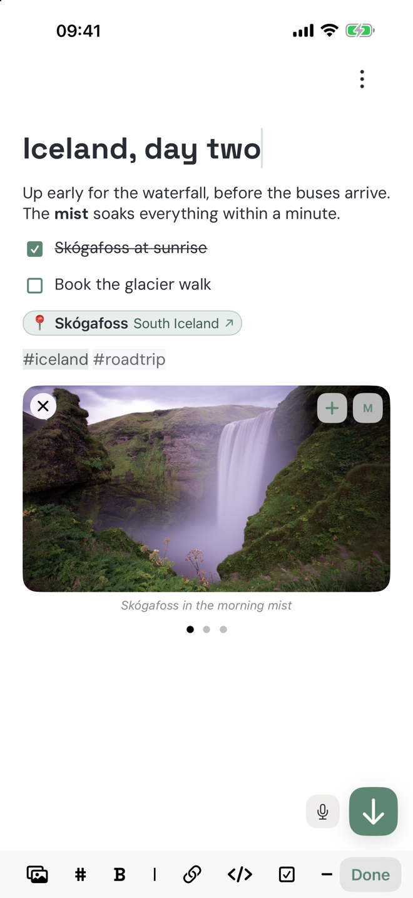
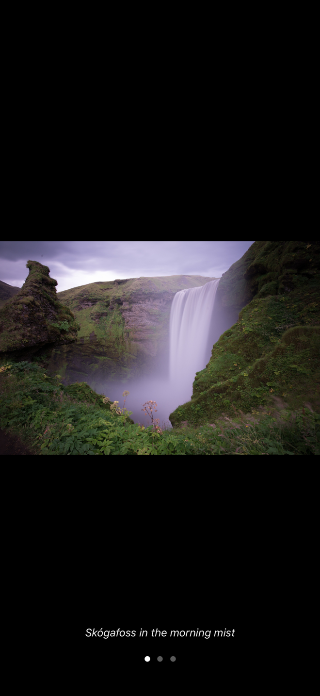

# KonuqEditorKit

The block editor behind [Konuq](https://apps.apple.com/app/konuq/id6766824990), a notes app for iOS. It is a UIKit table of blocks with a SwiftUI view for embedding, and every block reads and writes plain markdown.

<p align="center">
  
  &nbsp;&nbsp;
  
</p>

## Features

- Blocks for text, title, subtitle, four heading levels, bullet lists, checkboxes, collapsible toggles, code, images and video
- Inline markdown while typing: `**bold**`, `*italic*`, `~~strike~~`, `` `code` ``, `[links](https://example.com)` and `#tags`
- Links from a toolbar button, from ⌘K, or by pasting a URL over a selection
- Photo carousels: several photos in one block, a caption under each one, page dots, up to three photos side by side on wide screens, and a full-screen viewer that swipes through them
- Location chips: a `[📍 name](Apple Maps URL)` link drawn as a tinted pill with the place name and its area, with a search sheet and a colour picker to create one
- Selection mode for whole blocks, with copy, cut, delete and drag to reorder
- Copy as rich text (RTF and HTML) or as markdown with ⌘⇧C
- Undo and redo, hardware keyboard shortcuts, images dropped in from other apps
- Theming for fonts, accent, text and tag colours. DM Sans and Space Grotesk are bundled.
- Localized in 13 languages

## Requirements

- iOS 17 or later
- Swift 5.10 (Xcode 15.3 or later)

## Installation

In Xcode, File → Add Package Dependencies, or in `Package.swift`:

```swift
.package(url: "https://github.com/deruloop/KonuqEditorKit.git", from: "1.3.0")
```

## Usage

`BlocksEditorSwiftUIShellView` is the editor. `BlocksEditorShellModel` loads blocks into it and publishes them back after every edit.

```swift
import SwiftUI
import KonuqEditorKit

struct NoteScreen: View {
	@StateObject private var editor = BlocksEditorShellModel()

	var body: some View {
		BlocksEditorSwiftUIShellView(
			model: editor,
			onOpenURL: { url in UIApplication.shared.open(url) }
		)
		.onAppear {
			editor.setBlocks([
				EditorBlockSnapshot(id: UUID().uuidString, kind: .text(text: "Iceland, day two", style: .title), parentId: nil, position: 0),
				EditorBlockSnapshot(id: UUID().uuidString, kind: .text(text: "Up early for the **waterfall**.", style: .text), parentId: nil, position: 1),
				EditorBlockSnapshot(id: UUID().uuidString, kind: .text(text: "[ ] Book the glacier walk", style: .checkbox), parentId: nil, position: 2)
			])
		}
		.onChange(of: editor.blocks) { _, blocks in
			// [EditorBlockSnapshot] is Codable: encode it, or map it to a storage model.
			print(blocks.count)
		}
	}
}
```

### Blocks

A note is an array of `EditorBlockSnapshot`, ordered by `position`. Each snapshot has one of three kinds.

| Kind | Content |
| --- | --- |
| `.text(text:style:)` | Inline markdown, with a `TextStyle` such as `.text`, `.title`, `.heading3`, `.listBullet`, `.checkbox`, `.toggle` or `.code` |
| `.image(reference:displayStyle:caption:)` | One photo, its size (`.small`, `.medium`, `.large`) and a markdown caption |
| `.video(reference:displayStyle:)` | One video |

Image snapshots that follow each other with nothing in between show as one carousel. The stored note keeps one snapshot per photo, so a host that knows nothing about carousels still reads an ordinary list of images.

A checkbox keeps its state in the text, as `[ ] ` or `[x] ` at the start.

### Media

Picked photos and videos are copied into a `NoteMedia` folder and referenced as `media:<filename>`. The folder lives in the app group named by the `AppGroupIdentifier` key of the host's Info.plist, which lets extensions read the same files. Without that key it lives in Application Support.

`KonuqEditorMedia.loadJPEGData(for:)` turns a reference into JPEG data for export or upload.

### Locations

`EditorLocationLink.markdown(name:latitude:longitude:area:tintHex:)` builds the markdown for a location, and the editor draws it as a chip. `EditorLocationLink.place(from:)` parses a tapped URL back into a place, so the host decides which map app opens. `EditorLocationSearchSheet` is a ready-made search and pick screen.

### Appearance and language

```swift
KonuqEditor.theme = .app(accent: .systemIndigo)   // system fonts, custom accent
KonuqEditor.preferredLanguageCode = "it"          // nil follows the system
```

`KonuqEditorTheme.konuq` is the default look. Both values are set on the main thread before the editor appears.

## Status

The kit is built for Konuq and [Packd](https://apps.apple.com/app/packd/id6593688485) first, and its API follows what those two apps need. Releases use semantic versioning, and the notes for each one are on the [Releases](https://github.com/deruloop/KonuqEditorKit/releases) page.

## License

MIT. See [LICENSE](LICENSE).

The bundled DM Sans and Space Grotesk fonts are licensed under the SIL Open Font License 1.1. See [FONT_LICENSES.md](FONT_LICENSES.md).
